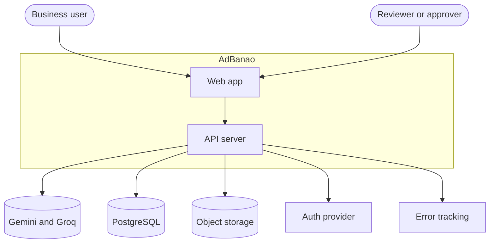
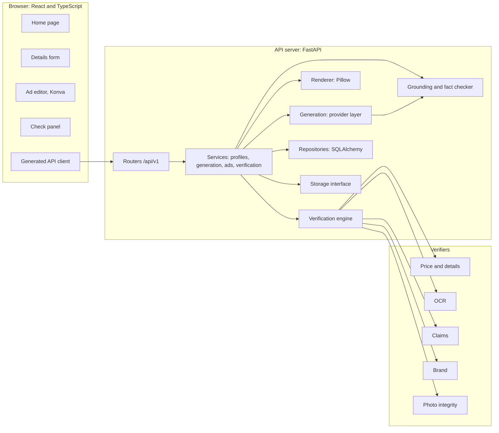
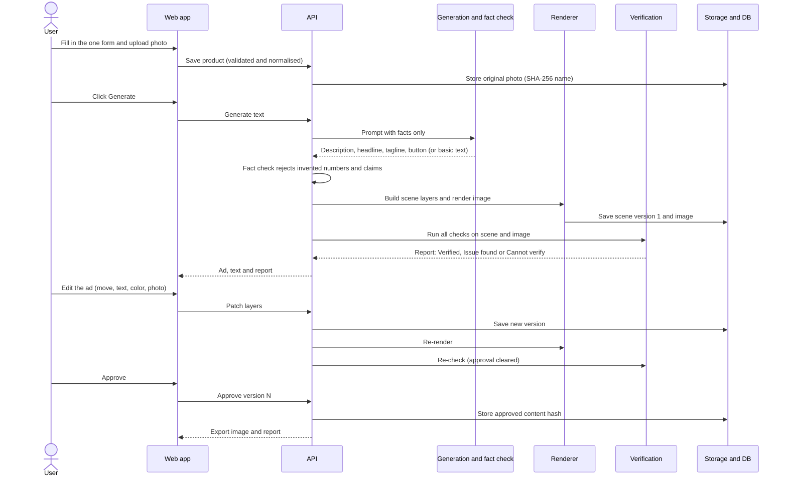
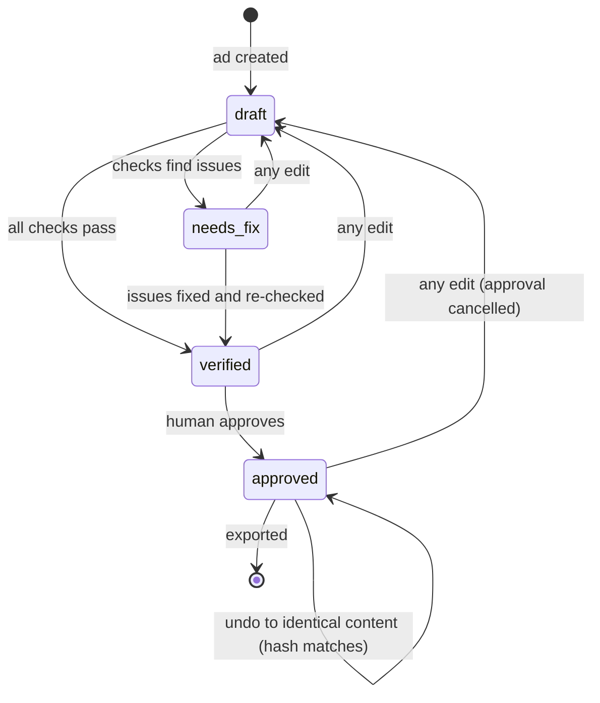
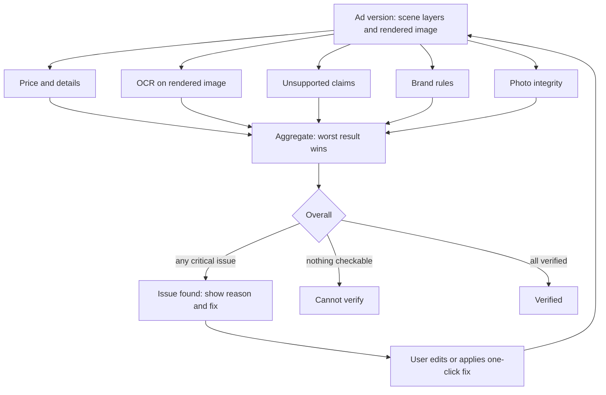
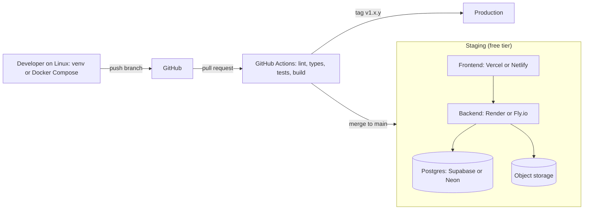

# System architecture

How the pieces fit together. All diagrams are Mermaid and render on GitHub.

## System context

## Containers and components

**Layering rule:** routers only translate HTTP. Services hold the logic. Pure modules (normalisation, grounding, scene schema, verifiers) import nothing from the web or database layers, so they can be tested anywhere. This is how 245 tests already run without a database.

## The main flow: from form to approved ad

## Ad status and approval rules

An approval is valid only while the ad's current content hash equals the approved content hash. Undo back to identical content makes the old approval valid again. Anything else does not.

## Verification pipeline

Rules every check follows:

1. Returns exactly one of `verified`, `issue_found`, `cannot_verify`.
2. Never returns `verified` without evidence. Empty or unreadable input gives `cannot_verify`.
3. Includes a plain-language reason, a severity (critical, warning, suggestion), and evidence (expected value and found value).
4. An empty report is `cannot_verify`, never "verified".

## Deployment

