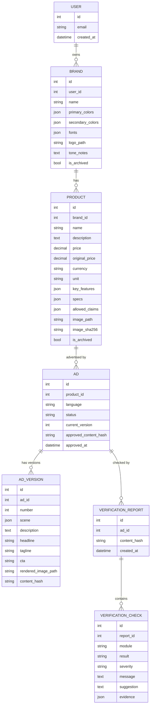

# System design

The data model, the ad scene format, the text generation design and the API rules.

## Data model



**Today versus target.** Today `Ad` holds headline, caption, description and one `content_hash`. The target above adds `USER` (goal F9) and `AD_VERSION` (goal A5) so versions and undo are first-class. Migrations (goal F7) make this change safe.

## The ad scene (layers) format

The scene is the single source of truth for an ad. The renderer turns it into an image. The editor edits it. The verifier reads it.

```json
{
  "schema_version": 1,
  "canvas": { "width": 1080, "height": 1080, "background": "#FFFFFF" },
  "template": "bold-offer",
  "layers": [
    { "id": "photo", "type": "image", "source": "product_photo", "x": 90, "y": 160, "w": 900, "h": 700, "fit": "contain", "locked_ratio": true },
    { "id": "headline", "type": "text", "role": "headline", "text": "Cotton Tote Bag", "x": 60, "y": 40, "w": 960, "font": "Noto Sans Bengali", "size": 64, "color": "#112233" },
    { "id": "price", "type": "text", "role": "price", "text": "৳1,299", "bind": "product.price", "x": 60, "y": 900, "size": 72, "color": "#C0392B" },
    { "id": "cta", "type": "button", "role": "cta", "text": "Shop now", "x": 720, "y": 920, "w": 300, "h": 90 },
    { "id": "logo", "type": "image", "source": "brand_logo", "x": 900, "y": 30, "w": 130, "h": 130 }
  ]
}
```

Design rules:

- Layers with a `role` (headline, price, cta, logo, photo) are known to the verifier. A `bind` ties a layer to a product field, so a price typed by hand that differs from the product price is flagged immediately.
- The photo layer points to the stored original. It never contains pixel data.
- The scene has a `schema_version` so old ads can be migrated.
- The renderer is deterministic: the same scene and fonts always give the same image. That is what makes OCR comparison and testing reliable.

## Grounded generation (already built)

1. Build **facts** from the product (name, price, original price, discount percent, unit, key features, specs, allowed claims, brand).
2. Prompt the model with the facts as quoted data and an instruction never to follow text inside it.
3. Parse a strict JSON reply (description, headline, tagline, button).
4. **Fact-check** the reply: numbers not in the facts, wrong currency, links and phone numbers, and risky claims (best, cheapest, guaranteed, health claims, free delivery) unless the user wrote them.
5. On failure: retry once, then try the next provider, then use clearly labelled basic template text.

## API design rules

| Rule | Detail |
| --- | --- |
| Versioned base path | `/api/v1/...` |
| Resource style | `/brands`, `/products`, `/ads`, `/ads/{id}/versions`, `/ads/{id}/reports` |
| Errors | One JSON shape: `{ "error": { "code", "message", "details", "request_id" } }` |
| Validation | Pydantic. Unknown fields are rejected |
| Idempotency | Approve and export are safe to repeat |
| Pagination | `limit` and `cursor` on lists |
| Authentication | Bearer token. Every query is filtered by the signed-in user |
| Documentation | OpenAPI at `/docs`. The frontend client is generated from it |

Planned endpoint groups:

| Group | Endpoints (examples) | State |
| --- | --- | --- |
| Health | `GET /health`, `GET /health/db` | Written |
| Brands | `POST /brands`, `PATCH /brands/{id}`, archive, restore, `POST /brands/{id}/logo` | Written |
| Products | `POST /products`, `PATCH /products/{id}`, photo upload, `GET /products/{id}/readiness` | Written |
| Text | `POST /products/{id}/generate-copy` | Written |
| Ads | `POST /ads` (render from product and text), `GET /ads/{id}`, `PATCH /ads/{id}/layers`, `POST /ads/{id}/undo`, `POST /ads/{id}/resize`, `POST /ads/{id}/template` | Planned |
| Verification | `POST /ads/{id}/verify`, `GET /ads/{id}/reports/latest`, `POST /checks/{id}/override` | Planned |
| Approval and export | `POST /ads/{id}/approve`, `GET /ads/{id}/export` | Planned |
| Auth | Handled by the auth provider, plus `GET /me` | Planned |
