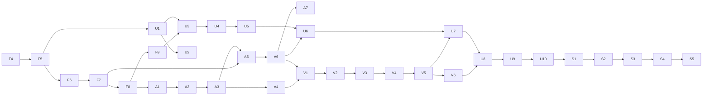

# Roadmap: 37 small goals

One goal per pull request. For what is finished today, see [PROGRESS.md](PROGRESS.md).

Each goal is one pull request with one purpose. Status: ✅ done and merged, 🟡 partly done, ⏭ next, ⬜ not started.

## Milestone M0: Foundation (F)

| ID | Goal (one small purpose) | Done when | Status |
| --- | --- | --- | --- |
| F1 | Repository and documents | README, contributing guide and overview exist | ✅ |
| F2 | Backend skeleton and database models | App starts, five models defined | ✅ (tests pass in CI) |
| F3 | Product and brand profiles | Create, edit, archive, upload photo, readiness report | ✅ (API tests pass in CI) |
| F4 | Grounded description and ad text | One route returns description, headline, tagline, button, with fact check and fallback | ✅ (route tests pass in CI, no real AI call) |
| F5 | Developer environment and quality gates | `make setup`, `make test`, `make lint` work on Linux. Ruff, mypy, pre-commit and GitHub Actions run on every pull request. Default branch is `main` and protected. Files in the planned structure | 🟡 Files and config are in place: Makefile, pyproject, pre-commit, CI workflow, templates, decision records, and the code is moved into the planned folders (lint and 245 tests pass here). GitHub Actions ran it on 2026-11-21: lint passes, 289 tests pass, mypy reported one finding (fixed). **Not yet run by you:** `make setup` and the pre-commit hooks. Branch protection not yet set |
| F6 | Run everything for real | All tests pass on your machine and in CI. Failures fixed. Your checklist ticked | 🟡 CI passes, and the owner's machine passed on 2026-11-22 (SQLite, fake AI). PostgreSQL 16 in Docker also passed (01:27). Still to do: a real Gemini or Groq key and a hosted database |
| F7 | Database migrations | Alembic creates and upgrades the schema. Local Postgres via Docker Compose. `key_features` column delivered as a migration | ✅ (PR #9; `make migrate`; a test checks the migration matches the models) |
| F8 | API foundations | `/api/v1` prefix, one error format with request IDs, structured logging, Gemini model name and keys as settings, health checks for database and providers | ⬜ |
| F9 | Authentication and ownership | Sign up and sign in. Every brand and product belongs to a user. A test proves one user cannot see another's data | ✅ Accounts (PR #9) and ownership: every brand belongs to a user, products and ads through the brand, every route is checked, and tests with three users prove nobody can see or change another's data. Password reset by email is not done and moves to a later goal |

## Milestone M1: Ad engine (A)

Approach decided 2026-11-24 ([ADR 0007](adr/0007-ad-engine-ai-designer.md)): Pillow renders templates, a text AI proposes the design as a scene, our code validates it first. The AI designer is built after A4. Order: F8, A1 to A4, the AI designer, A5 to A7.

| ID | Goal | Done when | Status |
| --- | --- | --- | --- |
| A1 | Scene (layers) schema | Scene JSON validated. Bad scenes rejected with clear messages. Content hash function exists | ⬜ |
| A2 | Fonts and text fitting | Bangla and English fonts bundled. Text fits its box (shrink, wrap, or warn). Bangla letters shape correctly (Raqm) | ⬜ |
| A3 | Renderer: one template, one size | A square ad renders from a scene. Original photo untouched (hash test) | ⬜ |
| A4 | Templates and sizes | Three templates, three sizes (square post, story, banner). Auto layout places photo, text, price badge and logo | ⬜ |
| A5 | Ad entity, versions and storage | Ads and versions saved. Storage interface with local and S3 implementations | ⬜ |
| A6 | Ad editing API | Patch layers, undo, redo. Every edit makes a version and clears approval | ⬜ |
| A7 | Resize, switch template, replace photo | Each re-runs layout and keeps the user's text. Replaced photo is hashed and compared with the product | ⬜ |

## Milestone M2: Verification (V)

| ID | Goal | Done when | Status |
| --- | --- | --- | --- |
| V1 | Verify prices and details | Every price, discount and unit in the ad and text matches the product. Equivalent formats are not flagged | ⬜ |
| V2 | Verify text with OCR | Rendered image read by Tesseract and compared with known layer text. Empty read gives "Cannot verify" | ⬜ |
| V3 | Verify unsupported claims | Rules first, optional AI second. Negation and outside-knowledge cases give "Cannot verify" | ⬜ |
| V4 | Verify brand and photo integrity | Colors, logo placement, contrast, and photo hash checked | ⬜ |
| V5 | Reports and one-click fixes | One report per version. Worst result wins. Fixes available for the common issues | ⬜ |
| V6 | Approval and export | Approval stored against the content hash. Export blocked unless approved and unmodified. Image and report downloadable | ⬜ |

## Milestone M3: Interface (U)

| ID | Goal | Done when | Status |
| --- | --- | --- | --- |
| U1 | Frontend scaffold | Vite, React, TypeScript, Tailwind, shadcn/ui, routing, light and dark theme, English and Bangla switch, generated API client, CI job | ⬜ |
| U2 | **Engaging home page** | Hero with live demo, before and after editing slider, how-it-works, features, trust section, call to action. Fast and accessible (details in section 14) | 🟡 Page added as static HTML in `frontend/index.html` (owner's design, images moved to files). Still to do: speed and accessibility audit, move to React |
| U3 | Sign-in screens and app shell | Sign up, sign in, dashboard with brands and products | 🟡 Sign-in and sign-up screens work against the real API, plus a profile page. Dashboard not started |
| U4 | Screen 1: Details | Guided form with examples, draft saving, photo upload, missing-data guidance | ⬜ |
| U5 | Screen 2: Generate | Progress states, review and edit generated text, basic-text label, retry | ⬜ |
| U6 | Screen 3: Editor | Konva canvas, layer panel, toolbar, undo and redo, size and template switch, photo replace | ⬜ |
| U7 | Check panel | Green, yellow, red cards with reasons, one-click fixes, override with reason | ⬜ |
| U8 | Screen 4: Approve and export | Approval, export, report download | ⬜ |
| U9 | Polish: accessibility, mobile, Bangla | Keyboard use, AA contrast, phone layouts, Bangla review | ⬜ |
| U10 | End-to-end tests | Full user journey runs in Playwright in CI | ⬜ |
| U11 | Admin console | Roles, suspension, activity log, admin page (light/dark, desktop/phone), CSV, tests in CI | 🟡 in review (docs/22-admin.md) |

## Milestone M4: Ship (S)

| ID | Goal | Done when | Status |
| --- | --- | --- | --- |
| S1 | Evaluation | 30 to 50 test ads with injected errors. Results table with catches, misses, false alarms, "Cannot verify" rate, review-time comparison | ⬜ |
| S2 | Production containers and config | Docker images build. Settings per environment. Health checks | ⬜ |
| S3 | Staging deployment and monitoring | Frontend, backend, database and storage on free tiers. Sentry and logs working | ⬜ |
| S4 | Security and resilience review | Checklist in [security and legal](11-security-and-legal.md) complete. Rate limits, backups, dependency audit | ⬜ |
| S5 | Documentation and release | User guide, runbook, demo script, name and domain check, `v1.0.0` tag | ⬜ |

## Mapping from the original 14 steps

| Original step | New goals |
| --- | --- |
| 1 Repo setup | F1 |
| 2 Backend skeleton | F2 |
| 3 Profiles | F3 |
| 4 Generation | F4 |
| 5 Ad design and renderer | A1 to A4 |
| 6 Editing API | A5 to A7 |
| 7 to 10 Verification | V1 to V4 |
| 11 Reports, approval, export | V5, V6 |
| 12 Frontend | U1 to U11 |
| 13 Evaluation | S1 |
| 14 Deployment and docs | S2 to S5 |
| New | F5 to F9 (professional foundations) |

## Dependencies

Note: U1 and U2 (scaffold and home page) can start right after F5, in parallel with the backend goals. That gives you something visual early, which is good for faculty demos and motivation. The rule "one goal at a time" still holds: we only choose the order.
