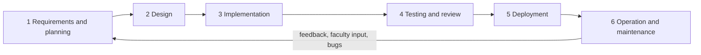
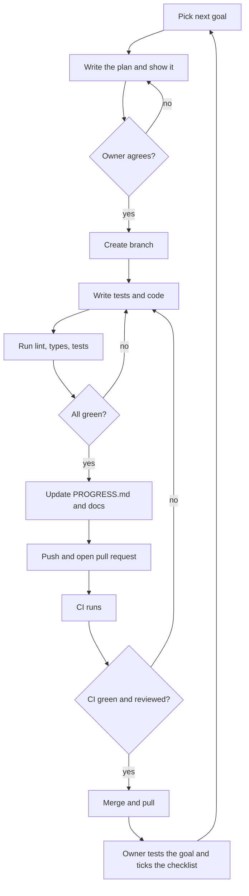
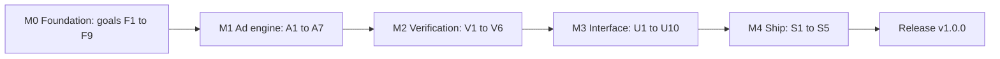
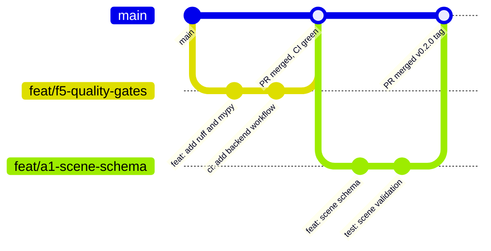
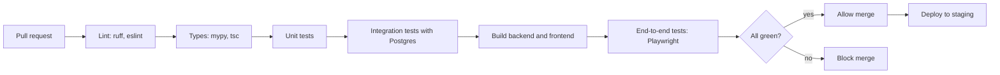

# Development process

How we build: the life cycle, release milestones, git workflow, code standards and CI.

## Software development life cycle

## Approach

We use an **iterative, Agile-style life cycle with short cycles**. Each cycle delivers one small goal as one pull request. Within each cycle we follow the classic SDLC phases, so nothing is skipped.

## What happens in each phase, for every goal

| Phase | What we do | Output | Where it is recorded |
| --- | --- | --- | --- |
| 1. Requirements and planning | Pick the next goal from the roadmap. Write its "done when" in plain words. Check faculty suggestions for anything that changes it | Goal with acceptance criteria | Section 13, GitHub issue |
| 2. Design | Say how it will be built, what files change, and show the plan first. Record any big decision as an ADR | Short plan, optional ADR | Issue or PR description, `docs/adr/` |
| 3. Implementation | Work on a short branch. Small commits with clear messages. Pure logic first, then wiring | Branch with code | Git |
| 4. Testing and review | Write tests with the code. Run lint, types and tests locally and in CI. Self-review the diff. The owner reviews before merge | Green CI, review notes | Pull request |
| 5. Deployment | Merge to `main`. CI builds. Staging updates automatically. Tags make releases | Running staging build | GitHub Actions |
| 6. Operation and maintenance | Watch errors and logs, fix bugs, update dependencies, update the progress log | Bug issues, changelog | `PROGRESS.md`, `CHANGELOG.md` |

## The cycle for one goal

## Release phases (milestones)

| Milestone | Outcome you can see | Version tag |
| --- | --- | --- |
| M0 Foundation | Everything built so far runs on your machine, is checked by CI, has migrations and sign-in | `v0.1.0` |
| M1 Ad engine | From the API, create a product and get a rendered image ad, edit its layers, undo | `v0.2.0` |
| M2 Verification | Every ad gets a report. Approval and export work | `v0.3.0` |
| M3 Interface | A complete product in the browser, with the engaging home page | `v0.4.0` |
| M4 Ship | Evaluated, secured, deployed, documented | `v1.0.0` |

Time per milestone is not estimated here, because it depends on how many hours you can give each week. After M0 we will have a measured speed per goal and can estimate honestly.

## Definition of Ready and Definition of Done

| Definition of Ready (a goal can start when) | Definition of Done (a goal is finished when) |
| --- | --- |
| It has one clear sentence of purpose | Code merged to `main` through a reviewed pull request |
| It has "done when" criteria that can be checked | New logic has tests, and tests pass locally and in CI |
| It depends on nothing that is not done | Lint and type checks pass |
| Any faculty suggestion affecting it has been decided | Docs, API description and `PROGRESS.md` are updated |
| The plan was shown and agreed | Anything not tested is written down as not tested |
| | You have run it yourself, or it is marked "not yet tested by owner" |

## Engineering rules

## Git workflow

| Rule | Detail |
| --- | --- |
| Default branch | `main`, protected: no direct pushes, pull request required, CI must pass |
| Branch names | `feat/<goal-id>-short-name`, `fix/...`, `docs/...`, `chore/...` |
| Commits | Conventional Commits: `feat:`, `fix:`, `docs:`, `test:`, `refactor:`, `chore:`, `ci:` |
| Size | One goal per pull request. Small enough to review in 15 minutes |
| After every merge | Pull `main` before starting the next goal |
| Versions | Semantic Versioning. Tags `v0.x.0` per milestone, `v1.0.0` on release |
| Releases | Changelog entry per release |
| Secrets | Never committed. `.env` is ignored. Secret scanning is on |

## Protecting the main branch

Do this once on GitHub, as the repository owner. It turns "CI must pass" from a habit into a rule, and stops a teammate from force-pushing over the history.

1. **Rename the default branch to `main` first** (Settings, General, Default branch, the pencil icon). GitHub retargets open pull requests. Everyone then runs `git fetch origin && git branch -m step-01-repo-setup main && git branch -u origin/main main`.
2. Settings, Branches, **Add branch ruleset** (or classic rule) for `main`:
   - Require a pull request before merging. Required approvals: 0 while the owner merges alone, 1 once teammates review.
   - Require status checks to pass: `test` and `end-to-end` (they show up in the list after the first CI run).
   - Block force pushes and block deletion.
   - Leave "do not allow bypassing" **off**, so the owner can still fix a broken pipeline.
3. Do not tick "require branches to be up to date" yet: with one pull request at a time it only adds waiting.

## Code standards

- Python: type hints everywhere, Ruff for lint and format, mypy for types, docstrings for public functions.
- TypeScript: strict mode, ESLint and Prettier, no `any` without a comment.
- Logic that can be pure is pure. Network and database calls live in adapters.
- Money is `Decimal`, never floating point.
- User text is always treated as data, never as instructions to the AI.
- Every external call has a timeout, a clear error, and a fallback where one makes sense.

## Review checklist (pull request template)

- [ ] One goal, one purpose
- [ ] Tests added and passing
- [ ] Lint and types pass
- [ ] No secrets, no stray debug output
- [ ] Docs and `PROGRESS.md` updated
- [ ] Anything untested is stated
- [ ] Faculty suggestion log checked

## CI/CD pipeline

