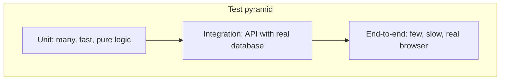

# Testing strategy

What is tested, with which tool, and what the gaps are.

| Level | Tool | What it covers | Today |
| --- | --- | --- | --- |
| Unit | pytest, Vitest | Normalisation, grounding, scene validation, verifiers, layout math | 245 passing locally, 289 in CI with the integration tests |
| Integration | pytest with a test Postgres | Routes, models, migrations, upload, approval invalidation | 44 run in CI on SQLite and pass. Local PostgreSQL passed on the owner's machine (2026-11-22). Hosted PostgreSQL not yet tried (goal F6) |
| End to end | Playwright | Whole journey: sign in, fill form, generate, edit, approve, export | Not started |
| Evaluation | Custom test set | 30 to 50 ads with injected errors. Reports catches, misses, false alarms, "Cannot verify" rate | Goal S1 |
| Security | Dependency audit, `bandit`, manual review | Uploads, auth, injection | Goal S4 |
| Accessibility | axe checks in Playwright | Keyboard, contrast | Goal U9 |
| Manual (owner) | Checklist in `PROGRESS.md` | What you ran yourself | Nothing reported yet |

Rules: every bug fix gets a test that fails before the fix. Coverage target is 80% or better on `domain/` and `verification/`. A feature is not "done" because it compiles; it is done when its tests ran.
